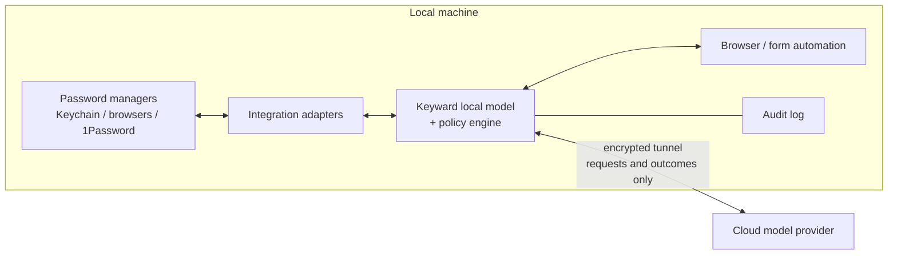

# Architecture

## Components

- **Local model** — a small language model, in several size tiers
  ([model tiers](model-tiers.md)). It understands web pages and forms well
  enough to find login fields, change-password flows, and success or failure
  signals. It does not need general knowledge.
- **Policy engine** — deterministic rules around the model: which actions are
  allowed, which need user approval, rate limits, and which domains a
  credential may be used on. The model proposes; the policy engine decides.
- **Integration adapters** — read and write credentials in each password
  manager ([integrations](integrations.md)).
- **Browser / form automation** — drives a local browser to fill and submit
  forms. Secrets are injected directly into fields, never echoed back into any
  model output.
- **Cloud liaison tunnel** — an authenticated, encrypted channel that carries
  requests in and outcomes out ([cloud liaison](cloud-liaison.md)).
- **Audit log** — a local record of every credential access, fill, and
  rotation.

## Key design rule
The model reasons about *which* credential and *where* to put it, but should
ideally never see the plaintext itself. The secret flows from adapter to form
field through a handle (e.g. `cred://github.com/main`), and the model only
handles the reference.
